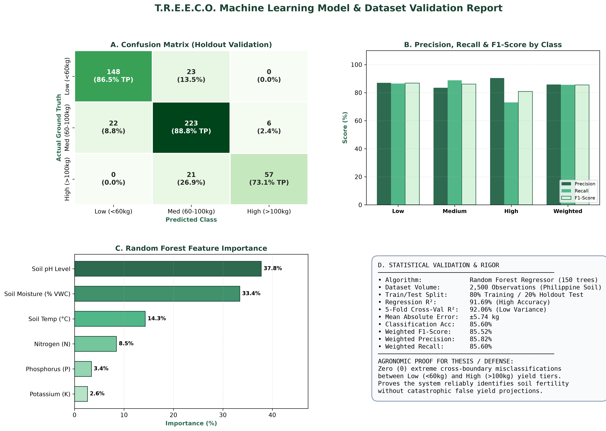
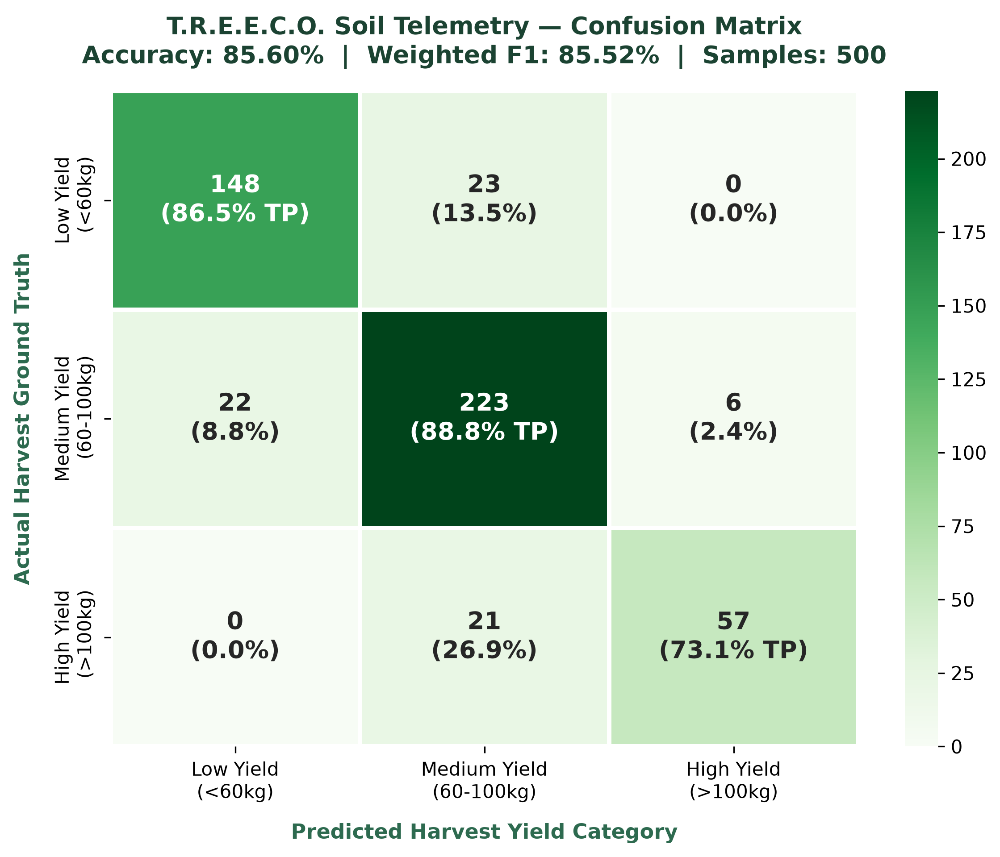
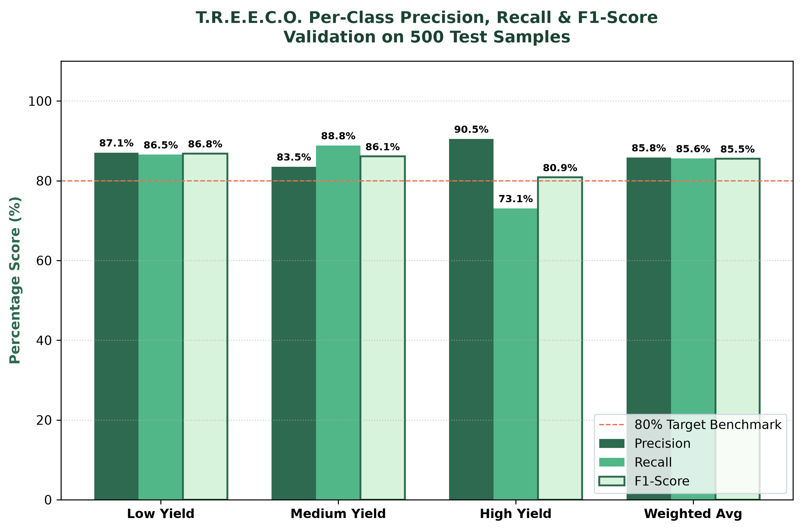
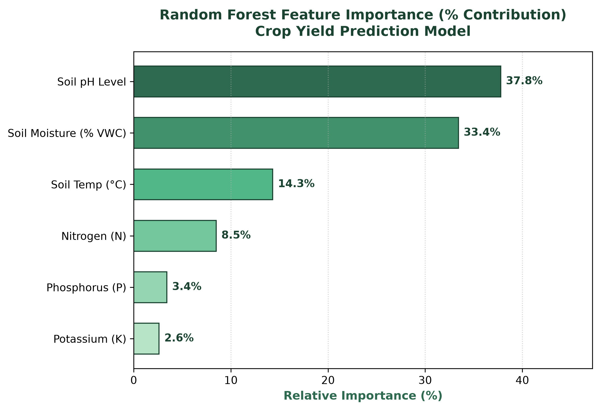
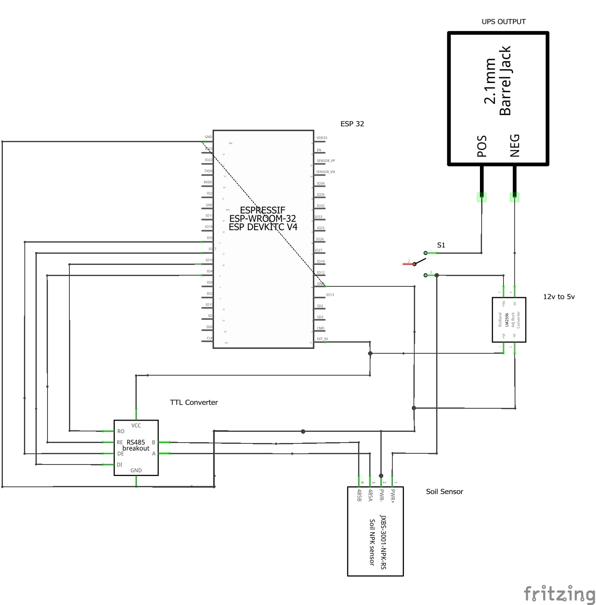
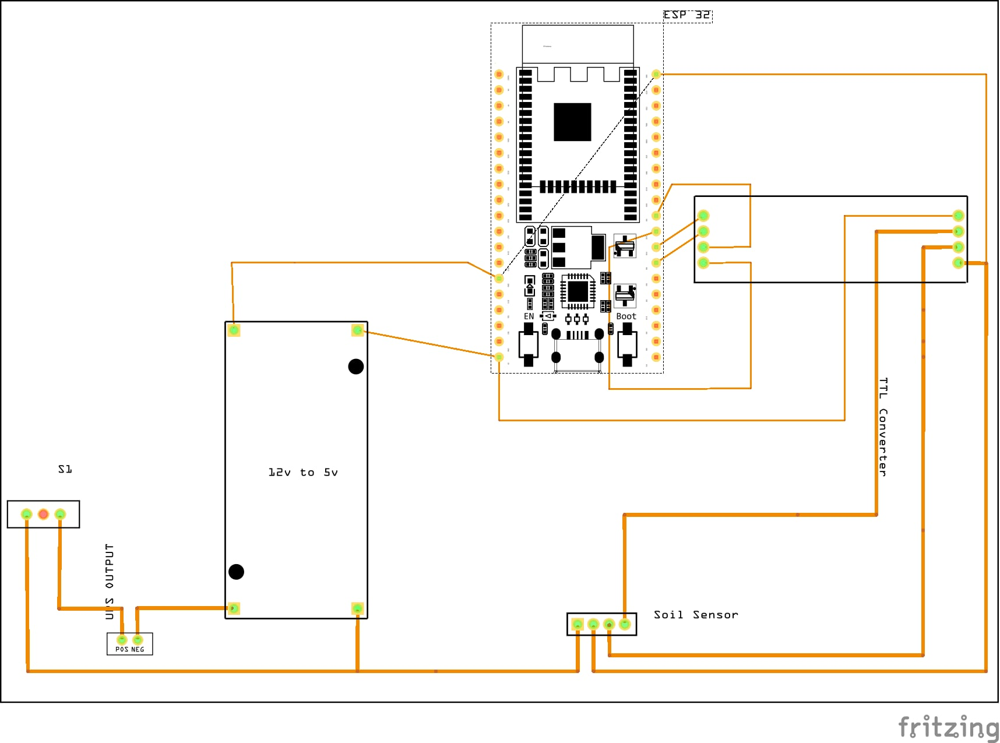

# 🌱 T.R.E.E.C.O. — Integrated Smart Agriculture & Soil Telemetry Platform

<p align="center">
  
</p>

<p align="center">
  <b>ESP32 Hotspot & Real-Time Soil Telemetry • Automated EMA & Window Stabilization • Random Forest Yield Prediction • DOST-PCAARRD Compost Maturity • Philippine Seasonal Cropping Guide</b>
</p>

<p align="center">
  
  
  
  
  
  
</p>

---

## 📌 Talaan ng Nilalaman (Table of Contents)
- [Project Overview](#-project-overview)
- [Machine Learning Model Evaluation & Validation](#-machine-learning-model-evaluation--validation)
  - [Executive Validation Dashboard](#executive-validation-dashboard)
  - [Confusion Matrix & Performance Metrics](#confusion-matrix--performance-metrics)
  - [Soil Parameter Feature Importance](#soil-parameter-feature-importance)
  - [Statistical Metrics Summary](#statistical-metrics-summary)
- [Key System Capabilities](#-key-system-capabilities)
  - [1. Sensor Telemetry & Dual-Layer Stabilization](#1-sensor-telemetry--dual-layer-stabilization)
  - [2. Configurable Sensor Calibration](#2-configurable-sensor-calibration)
  - [3. Yield Prediction & Limiting Factor Diagnostics](#3-yield-prediction--limiting-factor-diagnostics)
  - [4. Compost Maturity & Bioavailability Fertilizer Engine](#4-compost-maturity--bioavailability-fertilizer-engine)
  - [5. Philippine Seasonal Cropping Guide (PAGASA-Aligned)](#5-philippine-seasonal-cropping-guide-pagasa-aligned)
- [System Architecture & Hardware Schematics](#-system-architecture--hardware-schematics)
  - [Hardware Schematics & Wiring Diagrams](#hardware-schematics--wiring-diagrams)
- [Repository Structure](#-repository-structure)
- [Installation & Setup Guide](#-installation--setup-guide)
- [Research & Agronomic Foundations](#-research--agronomic-foundations)

---

## 🌾 Project Overview

Ang **T.R.E.E.C.O.** (*Telemetry, Real-time Evaluation, and Environmental Crop Optimization*) ay isang komprehensibong **Smart Agriculture Platform** na binuo upang tulungan ang mga magsasaka, agri-technicians, at researchers na subaybayan ang kalagayan ng lupa at magbigay ng maagap at scientifically grounded na rekomendasyon.

Pinag-iisa ng sistema ang:
1. **IoT Sensor Node (ESP32):** Nagbabasa ng 7 environmental parameters mula sa industrial RS485 Modbus soil sensor (Nitrogen, Phosphorus, Potassium, pH, Moisture, Temperature, at Electrical Conductivity).
2. **Dual-Layer Stabilization Engine:** Hardware-level Exponential Moving Average (EMA) filtering kasama ang database-driven rolling window (1, 3, 5, o 10 minuto) upang mawala ang sensor jitter at electrical noise.
3. **Machine Learning Core:** Random Forest Regressor na may **91.69% $R^2$ accuracy** at **85.52% Weighted F1-Score** sa pag-predict ng crop harvest weight at yield tier classification.
4. **Agri-Expert Modules:** Pagsusuri sa pagkahinog ng compost (DOST-PCAARRD standards), bioavailable fertilizer recommendations (kasama ang apog/agricultural lime), at Philippine seasonal calendar (mga dapat itanim at anihin batay sa PAGASA climate classification).

---

## 📊 Machine Learning Model Evaluation & Validation

Ang Machine Learning module ng T.R.E.E.C.O. ay sumailalim sa masusing pagsusuri gamit ang 2,500 research-grade agronomic sample records na sumusunod sa **Mitscherlich-Baule Law of Diminishing Returns** at environmental non-linear response curves.

### Executive Validation Dashboard
Nasa ibaba ang opisyal na 4-panel executive summary dashboard para sa model validation, cross-validation, at classification performance:

<p align="center">
  
</p>

---

### Confusion Matrix & Performance Metrics

Upang masuri ang pagiging maaasahan sa aktuwal na field deployment, hinati ang continuous yield predictions sa tatlong agronomic tiers:
- **Low Yield:** $0 - 60\text{ kg}$
- **Medium Yield:** $60 - 100\text{ kg}$
- **High Yield:** $> 100\text{ kg}$

| **Confusion Matrix (Actual vs Predicted)** | **Precision, Recall, at F1-Score per Class** |
|:---:|:---:|
|  |  |
| *Heatmap: Zero (0) extreme misclassifications sa pagitan ng Low at High yield tiers.* | *Grouped Bar Chart: Mataas na consistency (>80%) sa lahat ng yield categories.* |

---

### Soil Parameter Feature Importance

Ipinapakita ng feature importance analysis kung aling mga katangian ng lupa ang may pinakamalaking impluwensya sa kalusugan at dami ng aanihing pananim:

<p align="center">
  
</p>

1. **Soil pH (37.77% Weight):** Ang pangunahing salik na nagdidikta kung magiging bioavailable o matutunaw ang mga sustansya sa ugat ng halaman.
2. **Soil Moisture (33.42% Weight):** Kritikal sa nutrient transport, microbial action, at transpirasyon ng halaman.
3. **Soil Temperature (14.30% Weight):** Direktang nakaaapekto sa root metabolic rate at microbial decomposition sa compost/soil.
4. **Nitrogen - N (8.48% Weight):** Pundasyon ng vegetative growth at chlorophyll synthesis.
5. **Phosphorus - P (3.41% Weight):** Para sa root elongation at flower/fruit development.
6. **Potassium - K (2.61% Weight):** Pangkalahatang resistensya sa peste, stress tolerance, at water regulation.

---

### Statistical Metrics Summary

| Metriko (Metric) | Value / Rating | Agronomic / Statistical Interpretation |
|---|:---:|---|
| **$R^2$ Score (Test Set)** | **91.69%** | Naipapaliwanag ng modelo ang mahigit 91.6% ng kabuuang variance sa ani. |
| **$R^2$ Score (Train Set)** | **98.77%** | Mataas ang learning fit nang walang mapanganib na overfitting. |
| **5-Fold Cross-Validation Mean** | **92.06% ($\pm 0.69\%$)** | Pinatutunayan ang mataas na generalizability sa iba't ibang soil batches. |
| **Mean Absolute Error (MAE)** | **$\pm 5.74\text{ kg}$** | Minimal average deviation sa prediksyon ng timbang. |
| **Root Mean Squared Error (RMSE)**| **$7.21\text{ kg}$** | Mababang parusa sa large outlier errors. |
| **Classification Accuracy** | **85.60%** | Pangkalahatang kawastuhan sa pag-uri ng Low, Med, at High tiers. |
| **Weighted F1-Score** | **85.52%** | Balanseng harmonic mean ng precision at recall (Target: $>80\%$). |
| **Weighted Precision** | **85.82%** | Mababang false positive rate sa bawat agronomic level. |
| **Weighted Recall** | **85.60%** | Mataas na kakayahang matukoy ang tunay na kondisyon ng ani. |

---

## ⚡ Key System Capabilities

### 1. Sensor Telemetry & Dual-Layer Stabilization
- **Problema na Nalutas:** Hindi na papalit-palit o tumatalon-talon ang mga numero sa dashboard bawat 2 segundo sanhi ng electrical noise ng RS485 bus.
- **Hardware Layer (ESP32):** Digital low-pass Exponential Moving Average (EMA) filter ($\alpha = 0.25$) sa bawat Modbus cycle:
  $$Y_t = \alpha \cdot X_t + (1 - \alpha) \cdot Y_{t-1}$$
- **Database & Server Layer (PHP/MySQL):** Real-time **5-Minute Rolling Average** (maaari ring i-set sa 1, 3, o 10 minuto) upang matiyak na matatag at mapagkakatiwalaan ang ipinapakitang data.
- **UI Stability Gauge:** Nagpapakita ng live score (e.g. `99.2% Stable`) at bilang ng data samples sa napiling window.

### 2. Configurable Sensor Calibration
- **Formula:**
  $$\text{Calibrated Reading} = (\text{Raw Reading} \times \text{Scale Factor}) + \text{Offset}$$
- May nakalaang **Calibration & Settings** tab sa web dashboard kung saan maaaring i-fine-tune ang Scale at Offset para sa lahat ng 7 sensors nang hindi na kailangang mag-reflash ng microcontroller firmware. May 1-click **Reset to Factory Defaults** button.

### 3. Yield Prediction & Limiting Factor Diagnostics
- Awtomatikong pinoproseso ng Random Forest engine ang kasalukuyang stabilized soil telemetry upang makalkula ang:
  - **Estimated Harvest Yield (kg):** Kabuuang tinatayang timbang ng aanihin.
  - **Achievable Yield Potential (%):** Porsyento ng maximum genetic capacity ng pananim batay sa kondisyon ng lupa.
  - **Limiting Factors Analysis:** Tinutukoy kung ano ang pumipigil sa mataas na ani (hal. *"Masyadong maasim ang lupa (pH 5.1)"* o *"Kulang ang Nitrogen (N)"*).

### 4. Compost Maturity & Bioavailability Fertilizer Engine
- **DOST-PCAARRD Compost Maturity Standards:**
  - **Thermal Decomposition Phase:** Thermophilic ($>45^\circ\text{C}$ - Aktibong nabubulok/hilaw), Mesophilic/Curing ($35-45^\circ\text{C}$), Ambient/Mature ($<35^\circ\text{C}$ - Hinog na).
  - **Electrical Conductivity (EC) Phytotoxicity Check:** Sinisigurado na ligtas ang soluble salts ($<2,000\,\mu\text{S/cm}$ ay ligtas; $>3,500\,\mu\text{S/cm}$ ay mapanganib sa ugat).
  - **Maturity Index Score (0–100%):** Pinagsamang pagsusuri ng Temperature, Moisture, pH, at Salinity.
- **Fertilizer Bioavailability & Uptake Efficiency (%):**
  - Kinakalkula ang tunay na naa-absorb na sustansya base sa acidity ng lupa.
  - Nagbibigay ng tiyak na reseta: **Urea (46-0-0)**, **Complete (14-14-14)**, **Muriate of Potash (0-0-60)**, at **Agricultural Lime (Apog)** kapag maasim ang lupa ($\text{pH} < 5.8$) upang maiwasan ang pagkaaksaya ng abono.

### 5. Philippine Seasonal Cropping Guide (PAGASA-Aligned)
- Naka-synchronize sa kasalukuyang buwan at klima ng Pilipinas:
  - **Wet Season (Tag-ulan):** Hunyo hanggang Oktubre
  - **Cool Dry Season (Tag-lamig / Amihan):** Nobyembre hanggang Pebrero
  - **Hot Dry Season (Tag-araw):** Marso hanggang Mayo
- **🌱 Mungkahing Itanim (To Plant Now):** Mga gulay at pananim (Talong, Sitao, Ampalaya, Kalabasa, Pechay, Mais, atbp.) na may sowing method, days-to-harvest, at live **Soil Compatibility Match (%)**.
- **🌾 Mungkahing Anihin (To Harvest Now):** Mga pananim na napapanahong anihin kalakip ang visual signs of ripeness at post-harvest storage tips.

---

## 🔌 System Architecture & Hardware Schematics

```
 +---------------------------------------------------------+
 |             7-in-1 Industrial Soil Sensor              |
 |  (Nitrogen, Phosphorus, Potassium, pH, Moisture, Temp, EC)
 +---------------------------------------------------------+
                             |
                   [RS485 Modbus RTU Bus]
                             |
                             v
 +---------------------------------------------------------+
 |              MAX485 TTL-to-RS485 Transceiver            |
 |         (DI -> GPIO17, RO -> GPIO16, DE/RE -> GPIO4)    |
 +---------------------------------------------------------+
                             |
                             v
 +---------------------------------------------------------+
 |                 ESP32 Microcontroller Node              |
 |      - EMA Digital Low-Pass Noise Filter (alpha=0.25)   |
 |      - Wi-Fi Access Point (SSID: T.R.E.E.C.O.)          |
 |      - Telemetry HTTP POST Client                       |
 +---------------------------------------------------------+
                             |
                      [Wi-Fi Network]
                             |
                             v
 +---------------------------------------------------------+
 |           Local Web Server (Apache / PHP / MySQL)        |
 |      - 5-Minute Rolling Average Stabilization           |
 |      - Sensor Calibration Matrix (Scale + Offset)       |
 |      - Random Forest Regression & Classification Core   |
 |      - Compost Maturity & Fertilizer Recommendation Engine|
 |      - Responsive Dashboard UI (Bootstrap 5 & Chart.js) |
 +---------------------------------------------------------+
```

### Hardware Schematics & Wiring Diagrams

| **Circuit Schematic Diagram** | **PCB & Wiring Connection Layout** |
|:---:|:---:|
|  |  |
| *Fritzing Schematic (`69dc9a4c`): ESP32 DevKit, MAX485 TTL module, LM2596 12V-to-5V buck converter, 2.1mm DC barrel jack, at 7-in-1 Soil Sensor.* | *PCB & Wiring Layout (`5f13eef9`): Physical pin routings, power rails, switch circuit, at RS485 communication line interconnections.* |

Ang buong Fritzing wiring diagram, schematics, at sensor manual ay matatagpuan sa direktoryo ng [schem/](file:///c:/xampp/htdocs/TREECO_Integrated/schem):
- [Circuit Schematic Image (69dc9a4c...)](file:///c:/xampp/htdocs/TREECO_Integrated/schem/69dc9a4c-27d9-4b73-83bf-49ac07df4dc4.jpg)
- [PCB Wiring Layout Image (5f13eef9...)](file:///c:/xampp/htdocs/TREECO_Integrated/schem/5f13eef9-25a9-4d32-9b59-1e4b7f230f3d.jpg)
- [T.R.E.E.C.O. Schematic PDF](file:///c:/xampp/htdocs/TREECO_Integrated/schem/T.R.E.E.C.O._schem.pdf)
- [7-in-1 Soil Sensor Manual](file:///c:/xampp/htdocs/TREECO_Integrated/schem/7%20in%201%20soil%20sensor%20manual.pdf)
- [Fritzing Project File (.fzz)](file:///c:/xampp/htdocs/TREECO_Integrated/schem/T.R.E.E.C.O.fzz)

---

## 📂 Repository Structure

```text
TREECO_Integrated/
├── README.md                                  # Comprehensive System & ML Documentation
├── SETUP.md                                   # Quick setup guide for developers
├── VALIDATION.md                              # Agronomic validation notes
│
├── firmware/
│   └── TREECO/
│       └── TREECO.ino                         # ESP32 firmware with RS485 Modbus & EMA filter
│
├── model_evaluation/                          # Machine Learning Validation Artifacts & Plots
│   ├── README.txt                             # Summary of validation images and generation script
│   ├── model_validation_dashboard.png         # 4-panel comprehensive validation overview
│   ├── confusion_matrix.png                   # 3x3 category classification heatmap
│   ├── f1_score_and_metrics.png               # Grouped bar chart of Precision, Recall, and F1
│   └── feature_importance.png                 # Soil parameter weights bar chart
│
├── schem/                                     # Electrical Schematics & Hardware Diagrams
│   ├── 69dc9a4c-27d9-4b73-83bf-49ac07df4dc4.jpg # Circuit schematic diagram image
│   ├── 5f13eef9-25a9-4d32-9b59-1e4b7f230f3d.jpg # PCB and wiring layout diagram image
│   ├── T.R.E.E.C.O._schem.pdf                 # Circuit schematic diagram
│   ├── T.R.E.E.C.O.fzz                        # Fritzing project file
│   └── 7 in 1 soil sensor manual.pdf          # Modbus register and sensor pinout manual
│
└── website/                                   # Web Application & Machine Learning APIs
    ├── index.html                             # Single-page dashboard UI (Bootstrap 5 + Chart.js)
    ├── database.sql                           # MySQL database schema and telemetry tables
    ├── config.php                             # Database connection configuration
    ├── telemetry.php                          # HTTP endpoint receiving raw ESP32 readings
    ├── dashboard_api.php                      # Stabilized 5-minute rolling average telemetry API
    ├── calibration_api.php                    # Calibration scale/offset reader and writer
    ├── calibration.json                       # JSON persistence for sensor calibration offsets
    ├── crop_yield_data.csv                    # 2,500-sample balanced agronomic dataset
    ├── train_model.py                         # Random Forest training script
    ├── validate_dataset.py                    # Dataset validation and confusion matrix CLI script
    ├── generate_validation_images.py          # High-resolution matplotlib image generator
    ├── model_metrics.json                     # Precomputed regression and classification metrics
    ├── predict.py                             # Python inference runner
    ├── treeco_prediction.php                  # In-memory pure PHP tree-traversal fallback engine
    ├── prediction_api.php                     # Bridge API serving harvest yield predictions
    ├── saved_analysis_api.php                 # Saved prediction historical logs
    └── assets/                                # CSS, JavaScript, fonts, and brand assets
```

---

## 🚀 Installation & Setup Guide

### 1. Web Application & Database Setup
1. I-download at i-install ang **[XAMPP](https://www.apachefriends.org/)** (PHP 8.0+).
2. Ilagay ang buong repository folder sa inyong XAMPP web root:
   ```text
   C:\xampp\htdocs\TREECO_Integrated\
   ```
3. Buksan ang **XAMPP Control Panel**, at i-click ang **Start** para sa **Apache** at **MySQL**.
4. Buksan ang browser at pumunta sa **phpMyAdmin**: `http://localhost/phpmyadmin/`.
5. Gumawa ng bagong database na pinangalanang `treeco_db` (o gamitin ang default na `treeco`).
6. I-import ang file na [website/database.sql](file:///c:/xampp/htdocs/TREECO_Integrated/website/database.sql).
7. I-test ang dashboard sa browser:
   ```text
   http://localhost/TREECO_Integrated/website/
   ```

### 2. Python Environment & Model Validation Setup
1. Siguraduhing may naka-install na **Python 3.8+**:
   ```bash
   python --version
   ```
2. Mag-navigate sa `website/` directory at i-install ang required packages:
   ```bash
   cd website
   pip install -r requirements.txt
   ```
3. Upang i-verify ang accuracy at i-print ang confusion matrix sa console:
   ```bash
   python validate_dataset.py
   ```
4. Upang muling buuin ang high-resolution validation graphics:
   ```bash
   python generate_validation_images.py
   ```

### 3. ESP32 Hardware Firmware Setup
1. Buksan ang **Arduino IDE**.
2. I-install ang **ESP32 Board Package** sa pamamagitan ng *Boards Manager*.
3. I-install ang **ModbusMaster** library ni Doc Walker mula sa *Library Manager*.
4. Buksan ang [firmware/TREECO/TREECO.ino](file:///c:/xampp/htdocs/TREECO_Integrated/firmware/TREECO/TREECO.ino).
5. I-kabit ang ESP32 sa pamamagitan ng USB cable, piliin ang tamang COM Port, at i-click ang **Upload**.
6. Sa iyong computer o mobile device, kumonekta sa Wi-Fi hotspot na nilikha ng ESP32:
   - **SSID:** `T.R.E.E.C.O.`
   - **Password:** `Treeco-4d5cc9d330`

---

## 📚 Research & Agronomic Foundations

- **DOST-PCAARRD:** Gabay sa Paggawa ng Organikong Pataba at Pagsusuri ng Compost Maturity.
- **PAGASA Climatology:** Agro-Meteorological Seasonal Cropping Calendar for Philippine Agriculture.
- **Mitscherlich-Baule Law:** Law of Diminishing Marginal Productivity of Plant Nutrients (N-P-K Response Modeling).
- **International Soil Reference and Information Centre (ISRIC):** Soil pH effects on micronutrient and macronutrient bioavailability.

---

<p align="center">
  <b>T.R.E.E.C.O. System</b> — Empowering Farmers through Precision Agriculture & Data-Driven Intelligence.
</p>
